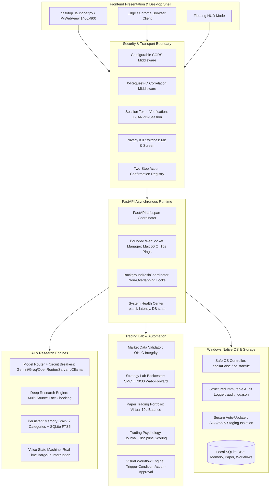
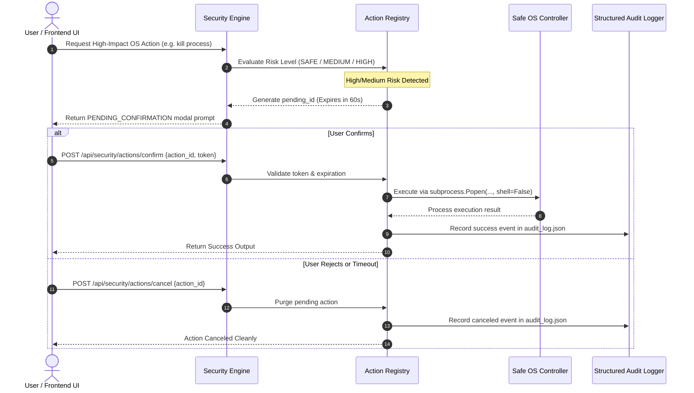
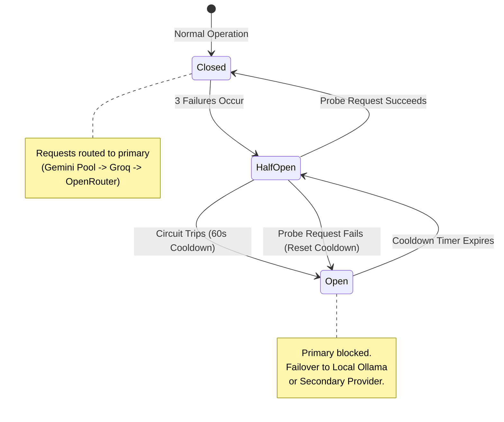
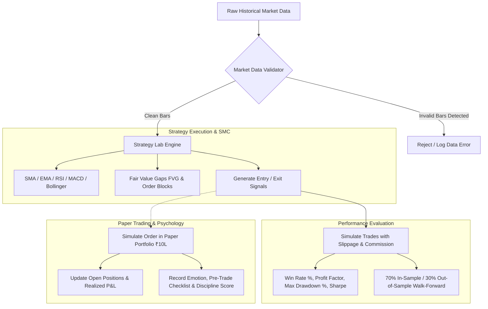
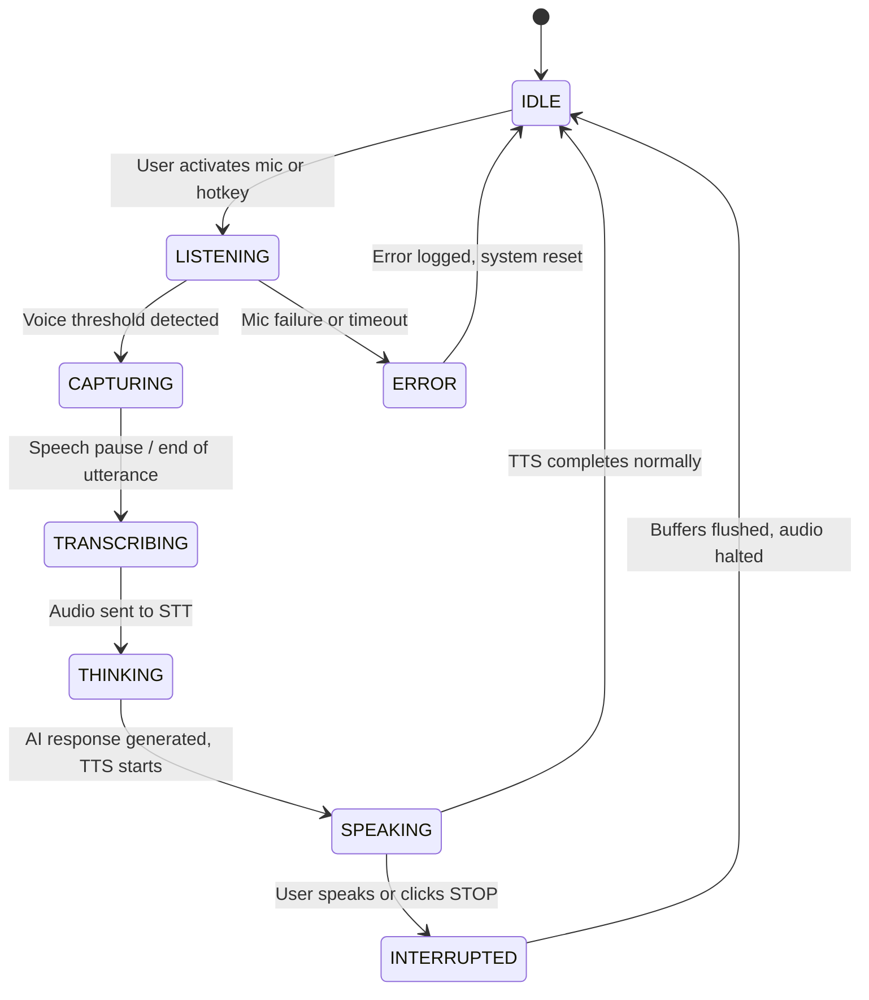
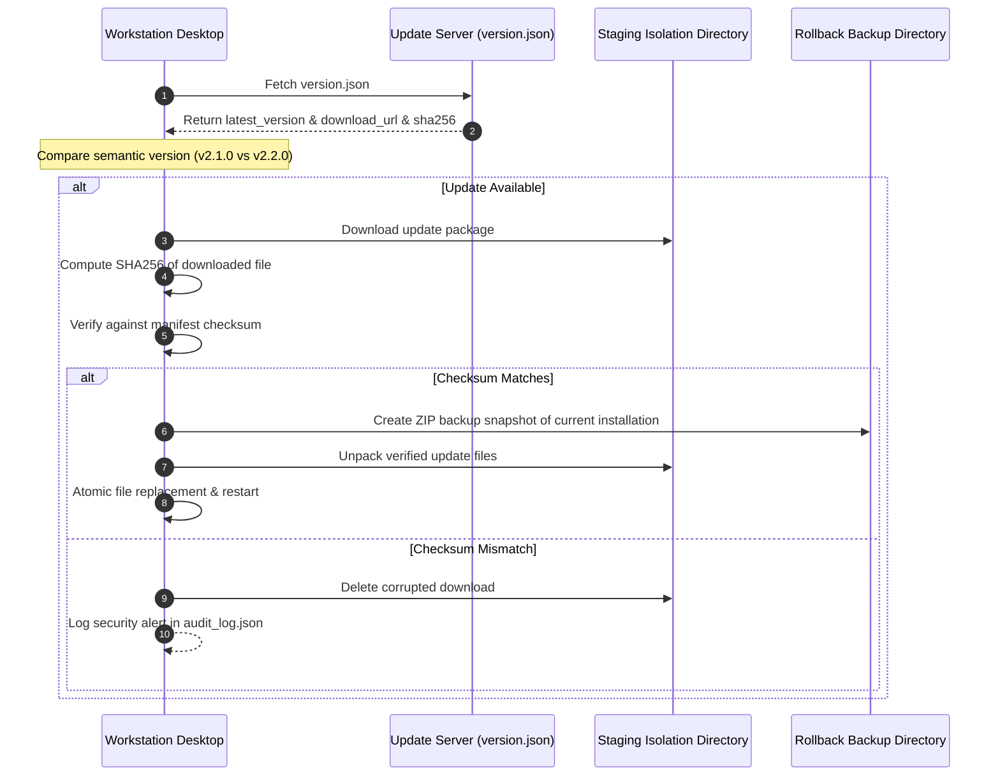

# JARVIS-APEX System Architecture (v2.1.0)

This document provides a comprehensive technical overview of the **JARVIS-APEX** Windows Desktop AI Workstation architecture, detailing its subsystems, concurrency model, data pipelines, security gates, and failure recovery mechanisms.

---

## 1. High-Level Architecture Topology

---

## 2. Concurrency & Asynchronous Runtime Model

### 2.1 FastAPI Lifespan & Clean Teardown
The core server lifecycle is managed through an asynchronous context manager (`@asynccontextmanager` in `backend/main.py`). Upon startup:
1. SQLite schemas are validated and auto-migrated using `PRAGMA user_version`.
2. Model circuit breakers are initialized with zero failure counts.
3. Background task workers (telemetry broadcast, memory sync) are spawned as tracked tasks.
4. Voice state is set to `IDLE`.

During graceful shutdown:
1. Cancellation signals are dispatched to all active background tasks.
2. Active WebSocket connections receive a close frame and their queues are flushed.
3. Database connection pools are finalized cleanly.

### 2.2 Bounded WebSocket Client Architecture (`backend/websocket_manager.py`)
To prevent unbounded memory growth and unresponsive socket handlers:
- **Per-Client Asyncio Lock:** Ensures serial write operations per TCP socket, preventing interleaved frame corruption.
- **Bounded Message Queues:** Each connected client maintains an internal queue bounded to 50 messages. If a slow client drops below capacity, overflow frames are dropped and logged, preventing memory leaks.
- **Heartbeat Ping/Pong:** A background task emits periodic pings every 15 seconds. Unresponsive clients that miss two consecutive pongs are disconnected cleanly.
- **Topic-Based Broadcast Routing:** Messages are segmented into distinct topics (`system_metrics`, `telemetry`, `voice_state`, `action_confirmation`, `market_data`), allowing granular subscription filters.

### 2.3 Non-Overlapping Background Task Coordinator (`backend/task_coordinator.py`)
Heavy background tasks (market scanning, deep research data extraction, cloud sync) utilize exclusive locks managed by `BackgroundTaskCoordinator`. If a job is already in progress, overlapping executions are safely skipped rather than queueing exponentially.

---

## 3. Security, Authentication & Safe OS Execution

### 3.1 Strict Process Execution
- Absolute ban on `shell=True` throughout `backend/os_controller.py`.
- Windows paths and applications execute via `subprocess.Popen([exe_path, ...], shell=False)` with validated arguments.
- Explorer windows and system settings open natively via Windows API `os.startfile(...)`.

### 3.2 Action Confirmation Registry (`backend/security.py`)
- Risk levels:
  - `SAFE`: Read-only queries, system metrics, volume controls, window focus.
  - `MEDIUM`: Opening applications, browser navigation, wallpaper changes.
  - `HIGH`: Killing running processes, deleting files, emptying the Windows Recycle Bin, executing workflow modifications.
- High-impact requests receive a cryptographically random UUID token and enter a 60-second approval window. The user is prompted with an interactive modal displaying exact arguments and safety consequences.

### 3.3 Hardware Privacy Kill Switches
- In-memory state flags (`mic_hardware_enabled`, `screen_hardware_enabled`) enforced at the lowest capture layer.
- When muted, microphone input buffers return zeroed silence, and screen vision capture endpoints return HTTP 403 Forbidden.
- Wake-word listener is initialized to `OFF` (`ENABLE_WAKE_WORD_DEFAULT=False`), preventing background microphone capture unless manually toggled.

---

## 4. AI Brain, Circuit Breakers & Fallback Matrix

### 4.1 Provider Fallback Chain
1. **Primary Cloud LLM:** Google Gemini Pool (Key 1 -> Key 2 -> Key 3 round-robin).
2. **Ultra-Low Latency Inference:** Groq LPU (`llama-3.3-70b-versatile`).
3. **Multi-Model Cloud Router:** OpenRouter API (`anthropic/claude-3.5-sonnet`, `deepseek/deepseek-r1`).
4. **Indic Voice / NLP:** Sarvam AI (Hindi audio transcription and text-to-speech).
5. **Private Sovereign Fallback:** Local Ollama running on `http://localhost:11434` (`llama3.2`, `mistral`, or `qwen2.5-coder`).

### 4.2 Circuit Breaker Specification
- **Failure Threshold:** 3 consecutive HTTP 5xx errors, timeouts (>15s), or quota exceedances (`RESOURCE_EXHAUSTED`).
- **Cooldown Interval:** 60.0 seconds.
- **Failover Logic:** When a circuit trips to `OPEN`, the router bypasses that provider and forwards the request to the next healthy provider in the fallback chain without raising an uncaught exception to the user.

---

## 5. Trading Strategy Lab & Paper Trading Pipeline

### 5.1 Market Data Validator
Before any backtest runs, incoming OHLC data is validated for:
- Price consistency: `High >= Open`, `High >= Close`, `Low <= Open`, `Low <= Close`, `Volume >= 0`.
- Timestamp ordering: Strictly ascending chronological ordering.
- Duplicate detection: Zero duplicate timestamps permitted.
- Staleness: Quotes older than 300 seconds are flagged as stale.

### 5.2 Algorithmic Backtester
- Supports technical crossover, mean-reversion, momentum, and Smart Money Concepts (FVG imbalances and Order Blocks).
- Realistic friction modeling: 0.05% execution slippage and ₹20 flat brokerage per leg.
- Overfitting prevention: Splitting datasets into 70% In-Sample (training) and 30% Out-of-Sample (testing).

### 5.3 Trading Psychology Engine
- Logs pre-trade emotional states: `Disciplined`, `Confident`, `FOMO`, `Revenge Trade`, `Greedy`, `Anxious`, `Hesitant`.
- Enforces a 4-point pre-trade compliance checklist:
  1. Setup aligns strictly with trading plan.
  2. Risk-reward ratio >= 1:2.
  3. Max loss per trade <= 2% of capital.
  4. Market condition verified without emotion.
- Computes an objective 0–100 Discipline Score and generates personalized mental risk warnings.

---

## 6. Voice Engine State Machine & Audio Interruption

### 6.1 Real-Time Audio Interruption Protocol
- `POST /api/voice/interrupt` immediately dispatches an abort signal to the TTS synthesis worker and active audio stream.
- Audio playback buffers are immediately cleared, and state transitions to `INTERRUPTED` before returning to `IDLE` in under 50ms.

---

## 7. Deep Research Workspace & Persistent Memory Brain

### 7.1 Multi-Source Research Engine
1. **Query Formulation:** Expands user query into search vectors.
2. **Multi-Source Fetch:** Queries verified search APIs, arXiv, PubMed, and open web.
3. **Fact Extraction:** Extracts entities, statistical assertions, and source citations.
4. **Cross-Source Verification:** Reconciles conflicting data points across independent domains.
5. **Report Generation:** Produces structured academic summaries and compact PDFs.
6. **Job Persistence:** Stored in SQLite (`research_jobs` table) with state transitions (`PENDING`, `GATHERING`, `ANALYZING`, `REPORTING`, `COMPLETED`, `FAILED`).

### 7.2 Persistent Memory Brain
- 7 Categories: `TRADING_RULE`, `SYSTEM_PREFERENCE`, `RESEARCH_TOPIC`, `USER_PROFILE`, `WORKFLOW_AUTOMATION`, `FINANCIAL_GOAL`, `GENERAL`.
- SQLite Full-Text Search (FTS5) enables sub-millisecond keyword and phrase queries.
- Schema versioning via SQLite `PRAGMA user_version`.
- JSON backup and restore capabilities via REST endpoints.

---

## 8. Visual Workflow Automation Studio

The workflow engine executes automated event-driven sequences:
- **Trigger:** Time schedule (`cron`), market price threshold, or manual event.
- **Condition:** Evaluated expression (e.g. `change_pct > 2.0` or `cpu_percent > 85.0`).
- **Action:** Allowlisted action only (`send_desktop_notification`, `log_audit_event`, `run_market_scan`, `create_memory_note`).
- **Approval Gate:** If flagged as `requires_approval=True`, pauses for user confirmation.
- **Dry-Run Mode:** Executes simulated run without executing external side-effects, generating a complete trace report.

---

## 9. Secure Auto-Updater Protocol

---

## 10. Summary
The JARVIS-APEX architecture provides enterprise-grade isolation, cryptographic security, multi-provider resiliency, and educational financial tooling within a responsive native Windows desktop environment.
