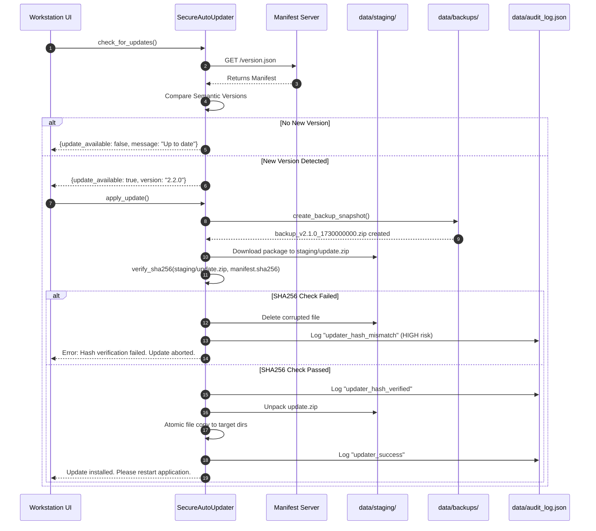

# JARVIS-APEX Cryptographic Auto-Updater Architecture (v2.1.0)

This document specifies the security policies, manifest schemas, verification workflows, and rollback procedures for the **SecureAutoUpdater** (`backend/auto_updater.py`).

---

## 1. Primary Objectives & Threat Model

Traditional auto-updaters often suffer from vulnerabilities including:
- Insecure HTTP downloads vulnerable to Man-in-the-Middle (MitM) attacks.
- Execution of corrupted or tampered binaries without cryptographic hash verification.
- Overwriting active runtime files without snapshot backups, leading to broken installations.
- Unauthenticated version tampering.

The **JARVIS-APEX Secure Auto-Updater** eliminates these risks through:
1. **Semantic Versioning Enforcement:** Protects against downgrade attacks.
2. **Mandatory SHA-256 Verification:** Every downloaded update package is hashed and compared against the signed remote manifest before unpacking.
3. **Staging Directory Isolation:** Updates are downloaded and extracted exclusively inside `data/staging/` to prevent contamination of active runtime files.
4. **Pre-Update Rollback Snapshots:** Before a single file is updated, a complete ZIP archive snapshot of the current working tree is created in `data/backups/`.
5. **Atomic Deployment & Audit Logging:** Every update attempt, checksum pass/fail, and rollback event is logged in `data/audit_log.json`.

---

## 2. Remote Update Manifest Schema (`version.json`)

To host an update, publish a static `version.json` file at a secure HTTPS endpoint (e.g., GitHub Releases, Cloudflare R2, AWS S3):

```json
{
  "latest_version": "2.2.0",
  "min_required_version": "2.0.0",
  "release_notes": "Added advanced SMC multi-timeframe analysis and Sarvam voice pipeline optimizations.",
  "download_url": "https://github.com/rkv3232-cell/JARVIS-AI-Workstation/releases/download/v2.2.0/jarvis_update_v2.2.0.zip",
  "sha256": "e3b0c44298fc1c149afbf4c8996fb92427ae41e4649b934ca495991b7852b855",
  "mandatory": false,
  "published_at": "2026-11-15T10:00:00Z"
}
```

### Manifest Field Specification
- `latest_version` *(string, required)*: Semantic version string (`MAJOR.MINOR.PATCH`).
- `min_required_version` *(string, required)*: Earliest compatible version that can directly upgrade to this release.
- `release_notes` *(string, optional)*: Markdown or plain-text description displayed in the UI.
- `download_url` *(string, required)*: HTTPS URL pointing directly to the update ZIP package.
- `sha256` *(string, required)*: 64-character lowercase hexadecimal SHA-256 hash of the ZIP package.
- `mandatory` *(boolean, optional)*: If `true`, prompts urgent notification to user.

---

## 3. Four-Phase Update Lifecycle



---

## 4. Rollback & Disaster Recovery Procedure

If an update is interrupted by a system shutdown, network drop, or corrupted package:

### Automated Rollback
If `apply_update()` catches an unexpected exception during file copying:
1. The updater automatically halts file copying.
2. The staging directory `data/staging/` is purged.
3. The pre-update backup archive is extracted back to restore original state.
4. An error event is logged in `data/audit_log.json`.

### Manual Snapshot Restoration
All rollback archives are permanently preserved in `data/backups/`:
```powershell
# List existing rollback backups
Get-ChildItem -Path d:\Trading\data\backups\

# To restore an older snapshot manually:
Expand-Archive -Path d:\Trading\data\backups\backup_v2.1.0_1730419200.zip -DestinationPath d:\Trading\ -Force
```

---

## 5. REST Endpoints

The updater is fully accessible through the FastAPI backend:

- `GET /api/system/version`: Returns current version, latest available version, and update status.
- `POST /api/system/update/check`: Forces an immediate remote manifest query.
- `POST /api/system/update/apply`: Initiates the staging download, SHA-256 verification, and backup snapshot creation.
