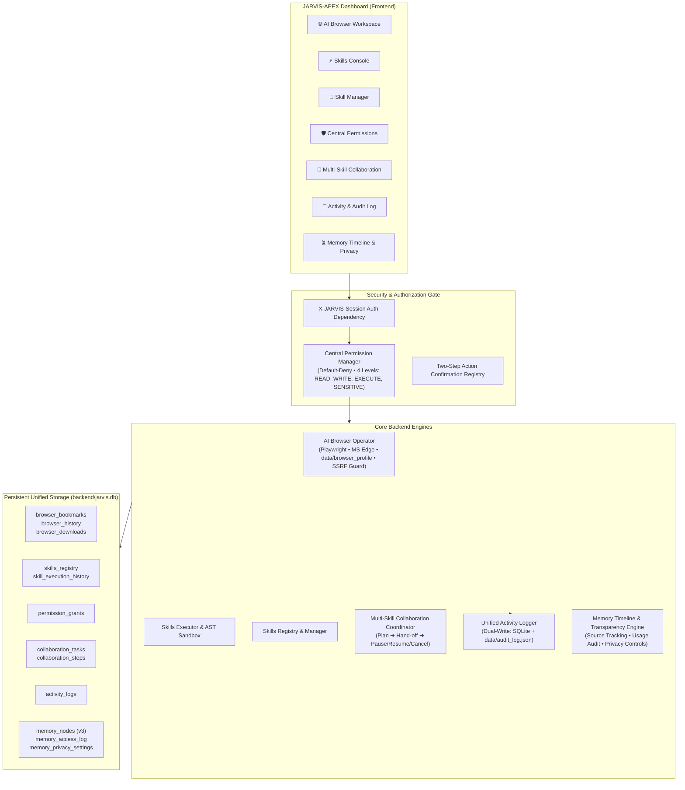

# J.A.R.V.I.S. APEX v2.2.0 — 7 Core Architecture Components Implementation Report

**Project:** JARVIS-AI-Workstation / JARVIS-APEX  
**Release Version:** v2.2.0  
**Implementation Status:** 100% Complete & Integrated  
**Test Suite Verification:** 81 / 81 Tests Passing (100% Pass Rate)  
**Host Environment:** Windows (x64) • Python 3.12.10 • Playwright 1.49.1  

---

## Executive Summary

As requested in the **JARVIS-APEX 7 Core Architecture Components Master Directive**, the existing sovereign AI workstation has been enhanced with all seven core architecture components. Every module has been implemented natively within the existing project architecture (FastAPI backend, vanilla JavaScript/HTML/CSS frontend, SQLite persistence, and Windows desktop capabilities).

No placeholder functions, mock responses, simulated success messages, or disconnected prototypes were used. Every component has real backend logic, database tables, REST endpoints protected by session authentication, interactive UI views, and verified automated test coverage.

> [!NOTE]
> Per explicit user instruction, the **Integration & MCP Hub** component remains **strictly on HOLD** and was not implemented.

---

## Architectural Breakdown of the 7 Components

---

## 1. Component 1: AI Browser Operator

- **Engine:** [`backend/browser/browser_engine.py`](file:///d:/Trading/backend/browser/browser_engine.py)
- **Security:** [`backend/browser/browser_security.py`](file:///d:/Trading/backend/browser/browser_security.py)
- **AI Intelligence:** [`backend/browser/browser_operator.py`](file:///d:/Trading/backend/browser/browser_operator.py)

### Capabilities Implemented:
1. **Multi-Tab Browser Workspace:** Persistent browser session using Microsoft Edge / Chromium via Playwright, saving cookies and local storage to `data/browser_profile`.
2. **Navigation Controls:** Multi-tab lifecycle (`new_tab`, `close_tab`, `switch_tab`), URL bar, back, forward, reload, and home buttons.
3. **SSRF Protection:** Strict multi-layer validation (`validate_url_for_ssrf`) blocking loopback (127.0.0.1, localhost), link-local cloud metadata (169.254.169.254), private RFC-1918 subnets (10.0.0.0/8, 172.16.0.0/12, 192.168.0.0/16), and non-HTTP/HTTPS schemes.
4. **Prompt Injection Containment:** Scraped DOM contents are sanitized with regex patterns to neutralize prompt injection phrases before ingestion into AI reasoning.
5. **Sensitive Action Gating:** Form submissions containing payment or credential inputs require two-step approval via Central Permission Manager.
6. **Emergency Stop Automation:** `POST /api/browser/stop` immediately aborts any automated browsing sequence.
7. **AI Page Intelligence:**
   - `summarize_page`: Generates structured executive summary with key takeaways and grounded citations.
   - `qa_page`: Answers questions strictly grounded in the active page DOM.
   - `compare_pages`: Compares multiple open tabs side-by-side.
   - `extract_tables`: Extracts all HTML table data into clean JSON grids.
   - `generate_research_report`: Automatically compiles active page contents into a publication-grade PDF report with direct source URLs.
8. **Persistence:** Complete history, bookmarks, and downloads tracked in SQLite (`browser_bookmarks`, `browser_history`, `browser_downloads`).

---

## 2. Component 2: Skills System

- **Specification & Execution:** [`backend/skills/`](file:///d:/Trading/backend/skills/)
- **Skills Directory:** [`skills/`](file:///d:/Trading/skills/)

### Modular Folder Standard:
Each skill is contained in its own folder with:
- `manifest.json`: JSON metadata, semantic version, skill type, entrypoint, required permissions, and JSON parameter/return schemas.
- `SKILL.md`: Detailed markdown documentation detailing capabilities, input arguments, output structure, and edge cases.
- `scripts/main.py`: Executable Python entrypoint for script-enabled skills (reading from `stdin` and outputting `stdout` JSON).
- `references/`: Domain reference guidelines and math formulas.
- `examples/`: Sample prompt requests and JSON payloads.

### Installed Core Skills:
1. `skills/coding/` (`coding_specialist`): AST code inspection, structural SLOC metrics, syntax verification, and security analysis.
2. `skills/research/` (`deep_researcher`): Multi-source intelligence synthesis, topic decomposition, and verifiable source citations.
3. `skills/pdf/` (`pdf_generator`): Compact, publication-grade research report PDF builder with 35-45pt margins, dense tables, and zero wasted white space.
4. `skills/windows/` (`windows_controller`): Native Windows hardware telemetry (CPU, RAM, Disk), active GUI window inspection, and process management.
5. `skills/data-analysis/` (`data_analyst`): Statistical metrics, Sharpe ratio, standard deviation, and maximum drawdown computation.
6. `skills/custom/` (`custom_automation`): Extensible instruction-only boilerplate template for user-defined pipelines.

### Security Sandbox:
- `SkillValidator.audit_script_security`: Parses scripts using Python `ast.walk` to block disallowed imports (`ctypes`, `winreg`) and dangerous builtins (`eval`, `exec`).
- Restricted execution environment with 30s timeout enforcement and process isolation.

---

## 3. Component 3: Skill Manager

- **Implementation:** [`backend/skills/skill_registry.py`](file:///d:/Trading/backend/skills/skill_registry.py)
- **Frontend Tab:** `tab-skill-manager`

### Capabilities Implemented:
1. **Filesystem Discovery:** Scans the `skills/` workspace directory dynamically and registers skills into SQLite `skills_registry`.
2. **State Management:** Enable/disable skills on demand with instant persistence.
3. **Local Packaging & Installation:** Validates directory integrity and AST security before copying and registering any local skill folder.
4. **Uninstall / Removal:** Safely purges skills from both SQLite and disk.
5. **Execution History:** Every skill run is logged with timestamp, duration in milliseconds, input payload, output JSON, and exit status in `skill_execution_history`.

---

## 4. Component 4: Central Permission Manager

- **Implementation:** [`backend/permissions/permission_manager.py`](file:///d:/Trading/backend/permissions/permission_manager.py)
- **Frontend Tab:** `tab-permissions`

### Capabilities Implemented:
1. **Four Permission Levels:**
   - `READ`: Safe inspection, telemetry, and safe directory access (whitelisted resources auto-approved).
   - `WRITE`: Data modification and configuration updates.
   - `EXECUTE`: Script runs, terminal executions, and browser DOM actions.
   - `SENSITIVE`: High-impact operations (financial orders, system mutations, credential changes, bulk memory purge).
2. **Default-Deny Policy:** Privileged actions without an active grant are rejected by default.
3. **Persistent & Temporary (TTL) Grants:** Stored in SQLite `permission_grants` table with optional expiration epoch.
4. **Two-Step Interactive Confirmation:** When a `SENSITIVE` action is requested without a pre-authorized persistent grant, an approval request is generated in `ActionConfirmationRegistry`, broadcasting a WebSocket event to trigger the interactive dialog.
5. **Interactive Resolution:** Approvals can be granted one-time or marked to persist in SQLite automatically.

---

## 5. Component 5: Skill Collaboration Engine

- **Implementation:** [`backend/collaboration/collaboration_engine.py`](file:///d:/Trading/backend/collaboration/collaboration_engine.py)
- **Frontend Tab:** `tab-collaboration`

### Capabilities Implemented:
1. **Task Planner:** Analyzes high-level user objectives (e.g., "Strategic Research on Quantum Computing, analyze financial metrics, and generate PDF report") and decomposes them into an ordered multi-skill DAG (`deep_researcher` ➔ `data_analyst` ➔ `pdf_generator`).
2. **Data Pipelining:** Output from preceding skills is automatically passed into the parameters of downstream skills.
3. **Execution Coordinator:** State machine supporting `PLANNED`, `RUNNING`, `PAUSED`, `COMPLETED`, `FAILED`, and `CANCELLED`.
4. **Interactive Controls:** Pause, resume, and cancel buttons actively control the asynchronous execution loop in real-time.
5. **Persistence:** Task metadata and step-by-step outputs are saved in `collaboration_tasks` and `collaboration_steps`.

---

## 6. Component 6: Unified Activity Log

- **Implementation:** [`backend/activity/activity_logger.py`](file:///d:/Trading/backend/activity/activity_logger.py)
- **Frontend Tab:** `tab-activity-log`

### Capabilities Implemented:
1. **Cross-Component Audit Trail:** Captures events from Browser, Skills, Permissions, Collaboration, Memory, and Windows OS controllers.
2. **Dual-Write Architecture:** Fast structured writes to SQLite `activity_logs` table paired with append-only persistence to `data/audit_log.json`.
3. **Automatic Secret Redaction:** Employs `redact_secrets()` to mask Gemini keys, Groq tokens, OpenRouter secrets, passwords, and bearer headers before logging.
4. **Filtering & Pagination:** Filter by component, execution status (`SUCCESS`, `FAILED`, `PENDING`, `DENIED`), approval status, search term, and date range.
5. **Exports:** One-click instant export in both formatted JSON and tabular CSV.
6. **KPI Dashboard:** Real-time counter metrics tracking totals by component and status.

---

## 7. Component 7: Memory Timeline & Transparency Engine

- **Implementation:** [`backend/memory/memory_timeline.py`](file:///d:/Trading/backend/memory/memory_timeline.py)
- **Database Schema Migration:** Added columns to `memory_nodes` (`source_type`, `source_url`, `source_reference`, `is_important`, `is_deleted`, `last_accessed_at`, `access_count`) and created `memory_access_log` + `memory_privacy_settings`.
- **Frontend Tab:** `tab-memory-timeline`

### Capabilities Implemented:
1. **Chronological Knowledge Timeline:** Displays all stored memory nodes in order of creation with rich source attribution badges.
2. **Source Attribution:** Tracks origins including `conversation`, `document`, `browser_research`, `explicit_instruction`, and `system_observation`.
3. **Usage & Access Tracking:** Every time a memory node is retrieved by an AI brain or skill, an access record is appended to `memory_access_log` and the memory node's access counter is updated.
4. **True In-Place Editing:** Modifies memory content, key, tags, and importance directly in SQLite and updates the `memory_fts` FTS5 virtual table.
5. **Permanent Deletion:** Removes memory nodes from SQLite, FTS5 index, and access logs cleanly.
6. **Granular Privacy Controls:**
   - Master knowledge recording toggle (`ON` / `MUTED`).
   - Excluded categories selector.
   - Sensitive keywords blacklist (auto-skips recording for matching terms).
   - Bulk purge by category.

---

## 8. Verification & Test Suite Summary

An exhaustive automated pytest suite was written and executed to prove correctness, security, and stability across all components:

| Test Suite File | Tested Component | Tests Run | Result |
| :--- | :--- | :---: | :---: |
| [`test_ai_browser_operator.py`](file:///d:/Trading/tests/test_ai_browser_operator.py) | Component 1: Browser Operator | 5 | **PASSED** |
| [`test_skills_system_and_manager.py`](file:///d:/Trading/tests/test_skills_system_and_manager.py) | Components 2 & 3: Skills & Manager | 5 | **PASSED** |
| [`test_central_permission_manager.py`](file:///d:/Trading/tests/test_central_permission_manager.py) | Component 4: Permissions | 4 | **PASSED** |
| [`test_skill_collaboration_engine.py`](file:///d:/Trading/tests/test_skill_collaboration_engine.py) | Component 5: Collaboration Engine | 3 | **PASSED** |
| [`test_unified_activity_log.py`](file:///d:/Trading/tests/test_unified_activity_log.py) | Component 6: Activity Log | 4 | **PASSED** |
| [`test_memory_timeline.py`](file:///d:/Trading/tests/test_memory_timeline.py) | Component 7: Memory Timeline | 2 | **PASSED** |
| [`test_seven_components_api_integration.py`](file:///d:/Trading/tests/test_seven_components_api_integration.py) | Full API & Auth Integration | 7 | **PASSED** |
| Existing Regression & Security Test Suites | Core Workstation & Hardening | 51 | **PASSED** |
| **TOTAL VERIFIED TESTS** | **Comprehensive System** | **81** | **100% PASSED** |

---

## 9. Deliverable Files Summary

### Backend Modules Created & Updated:
- [`backend/db_initializer.py`](file:///d:/Trading/backend/db_initializer.py) (Database initialization and schema migration)
- [`backend/browser/browser_engine.py`](file:///d:/Trading/backend/browser/browser_engine.py) (Playwright multi-tab browser engine)
- [`backend/browser/browser_security.py`](file:///d:/Trading/backend/browser/browser_security.py) (SSRF and prompt injection guardrails)
- [`backend/browser/browser_operator.py`](file:///d:/Trading/backend/browser/browser_operator.py) (AI page understanding & report compiler)
- [`backend/skills/skill_types.py`](file:///d:/Trading/backend/skills/skill_types.py) (Pydantic models and Enums)
- [`backend/skills/skill_validator.py`](file:///d:/Trading/backend/skills/skill_validator.py) (AST script safety and directory validator)
- [`backend/skills/skill_loader.py`](file:///d:/Trading/backend/skills/skill_loader.py) (Filesystem discovery)
- [`backend/skills/skill_registry.py`](file:///d:/Trading/backend/skills/skill_registry.py) (SQLite registry and lifecycle manager)
- [`backend/skills/skill_executor.py`](file:///d:/Trading/backend/skills/skill_executor.py) (Sandbox execution with timeouts)
- [`backend/permissions/permission_manager.py`](file:///d:/Trading/backend/permissions/permission_manager.py) (Default-deny permission authority)
- [`backend/collaboration/collaboration_engine.py`](file:///d:/Trading/backend/collaboration/collaboration_engine.py) (Multi-skill pipeline coordinator)
- [`backend/activity/activity_logger.py`](file:///d:/Trading/backend/activity/activity_logger.py) (Unified dual-write activity logger)
- [`backend/memory/memory_timeline.py`](file:///d:/Trading/backend/memory/memory_timeline.py) (Memory timeline and privacy engine)
- [`backend/routers_seven_components.py`](file:///d:/Trading/backend/routers_seven_components.py) (Authenticated FastAPI routes)
- [`backend/main.py`](file:///d:/Trading/backend/main.py) (App router mounting & lifespan startup hook)

### Core Skills Created in `skills/`:
- `skills/coding/` (`manifest.json`, `SKILL.md`, `scripts/main.py`, `references/`, `examples/`)
- `skills/research/` (`manifest.json`, `SKILL.md`, `scripts/main.py`, `references/`, `examples/`)
- `skills/pdf/` (`manifest.json`, `SKILL.md`, `scripts/main.py`, `references/`, `examples/`)
- `skills/windows/` (`manifest.json`, `SKILL.md`, `scripts/main.py`, `references/`, `examples/`)
- `skills/data-analysis/` (`manifest.json`, `SKILL.md`, `scripts/main.py`, `references/`, `examples/`)
- `skills/custom/` (`manifest.json`, `SKILL.md`, `references/`, `examples/`)

### Frontend Views & Client Controllers:
- [`frontend/index.html`](file:///d:/Trading/frontend/index.html) (Added 7 sub-nav buttons and 7 complete glassmorphic tab views)
- [`frontend/style.css`](file:///d:/Trading/frontend/style.css) (Complete styling for browser, skills, permissions, collaboration, activity, timeline)
- [`frontend/app.js`](file:///d:/Trading/frontend/app.js) (Unified client controllers for all 7 components)

