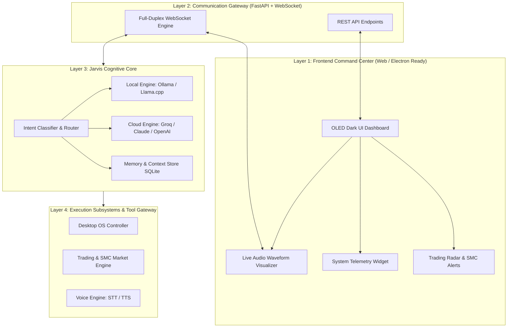

# 🌐 PROJECT JARVIS-APEX: SYSTEM BLUEPRINT
**Autonomous Personal AI Assistant & Quantitative Trading Command Center**

---

## 🏛️ EXECUTIVE SUMMARY & LIFECYCLE COMMITMENT

In accordance with the **OMNI-APEX MASTER PROTOCOL (Phase 0: Think & Plan Before Code)**, this document establishes the full Product Requirements Document (PRD), System Architecture, Data Contracts, and Phased Implementation Roadmap **prior to writing any production code**.

---

## 📋 SECTION 1: PRODUCT REQUIREMENTS DOCUMENT (PRD)

### 1.1 Product Vision & Core Mission
**JARVIS-APEX** is an ultra-fast, local-first, voice-interactive personal AI assistant engineered specifically for **active traders, software engineers, and power users**. It merges the local autonomy principles of OpenJarvis with high-precision quantitative market analysis and a stunning Apple/Stripe-grade dark glassmorphic command center.

### 1.2 User Personas & Real-World User Journeys
1. **The Active Market Trader:**
   - *"Jarvis, scan Nifty and Crypto for 15-minute Fair Value Gaps and Order Blocks."*
   - Jarvis calculates structure, evaluates risk-reward ($> 1:2.5$), alerts via desktop popup/audio chime, and tracks price action.
2. **The Autonomous Workflow Operator:**
   - *"Jarvis, prepare my morning workstation: open Chrome to TradingView, start the local database, and give me a brief of system CPU/RAM."*
   - Jarvis executes OS-level commands safely, opens targets, and reports system health via synthetic voice.
3. **The Voice-First Knowledge Partner:**
   - Natural, hands-free conversation with sub-second voice reply latency without keeping a browser tab active.

---

### 1.3 Feature Matrix & Scope Classification

| Priority | Feature Module | Functional Requirement |
| :--- | :--- | :--- |
| **P0 (Must-Have)** | **Core Engine & Multi-Brain** | Hybrid LLM Router: Local Ollama (offline privacy) + Cloud API fallbacks (Groq / OpenRouter / Anthropic). |
| **P0 (Must-Have)** | **Iron Man Arc Dashboard** | OLED Dark UI (`#07080b`), translucent cards, live audio waveform visualizer, responsive telemetry widgets. |
| **P0 (Must-Have)** | **Desktop Automation Agent** | Safe OS execution: App launching, file semantic search, hardware stats (CPU, RAM, GPU, Disk). |
| **P0 (Must-Have)** | **Voice Interaction Pipeline** | Low-latency Speech-to-Text (STT) and natural Text-to-Speech (TTS) with interruption handling. |
| **P1 (High Priority)**| **SMC Market Scanner** | Real-time market data ingestion, Order Block (OB) validator, Fair Value Gap (FVG) detector. |
| **P1 (High Priority)**| **Trading Alert Engine** | Telegram / Discord webhook alerts + Desktop push notifications for high-probability setups. |
| **P2 (Delighters)**   | **Autonomous Task Scheduler**| Morning briefing cron, automated log rotation, and memory graph persistence across sessions. |

---

### 1.4 Non-Functional Requirements (Performance & Security SLAs)

```
┌─────────────────────────────────────────────────────────────┐
│ PERFORMANCE & SECURITY CONSTRAINTS                          │
│ 1. Voice Reply Latency:      < 800ms (Total turnaround)     │
│ 2. UI Frame Rate:            Stable 60 FPS on all transforms│
│ 3. Memory Footprint:         < 250 MB idle RAM (Backend)    │
│ 4. API Key Security:         Zero hardcoded keys (.env only)│
│ 5. Execution Sandboxing:     Restricted path whitelist for OS│
└─────────────────────────────────────────────────────────────┘
```

---

## 📐 SECTION 2: TECHNICAL SYSTEM ARCHITECTURE

### 2.1 High-Level Architecture Topology



---

### 2.2 Subsystem Specifications

#### A. Cognitive Core & Model Orchestration
- **Router Pattern:** Queries are categorized into `CASUAL_CONVERSATION`, `DESKTOP_ACTION`, or `MARKET_QUERY`.
- **Latency Optimization:** Simple commands (e.g., "mute volume", "open chrome") bypass the cloud and execute locally in $< 100\text{ms}$.
- **Memory Store:** SQLite database tracking:
  - `conversations` (chat history with token counts)
  - `user_preferences` (name, trading symbols of interest, voice speed)
  - `action_logs` (audit trail of all OS/system commands executed)

#### B. Voice & Audio Loop (Zero-Lag Design)
- **Speech-to-Text (Input):** Web Speech API for instant client-side transcription + Whisper API/Local fallback for high accuracy.
- **Text-to-Speech (Output):** High-speed streaming TTS with edge voice profiles (natural British/Indian/US accents, pitch and rate controllable).
- **Audio Feedback:** Real-time visual audio waveform rendered on an HTML5 2D Canvas matching incoming and outgoing audio frequencies.

#### C. Quantitative Trading & FinTech Engine
- **Data Ingestion:** Non-blocking async fetcher for Crypto (CCXT/Binance) and Indian Equities (Yahoo Finance / Zerodha Kite Webhook).
- **Algorithmic Signal Pipeline:**
  1. Candle Aggregation (5m, 15m, 1h, 1D).
  2. Institutional Order Block (OB) identification.
  3. Fair Value Gap (FVG) detection (3-bar imbalance checks).
  4. Risk:Reward calculation ($> 1:2.5$ threshold enforcement).
- **Notification Hub:** Live alert dispatch via system chime and desktop notification.

#### D. Desktop OS & System Controller
- **System Monitoring:** Psutil background thread streaming CPU, RAM, Disk, and Network ping every 2 seconds via WebSocket.
- **Process Automation:** Whitelisted command runner (Launch Chrome, Code, Notepad, Terminal, Spotify, etc.).
- **Safety Boundary:** Prohibits destructive system commands (`format`, `del /s /q C:\*`, registry edits).

#### E. Frontend Aesthetics (Apple / Stripe / Sci-Fi Standard)
- **Color Palette:**
  - Background: Deep OLED `#07080b` with layered radial glows (`rgba(59, 130, 246, 0.08)`).
  - Cards: `rgba(255, 255, 255, 0.03)` with `backdrop-filter: blur(20px)` and fine borders `rgba(255, 255, 255, 0.07)`.
  - Accents: Electric Cyan (`#00f2fe`), Arc Indigo (`#6366f1`), Emerald Profit (`#10b981`), Coral Alert (`#f43f5e`).
- **Typography:** Outfit / Plus Jakarta Sans for UI headers, JetBrains Mono for metrics and timestamps.

---

### 2.3 Data Models & API Contracts

#### WebSocket Event Contract:
```json
{
  "event": "voice_transcript" | "agent_response" | "system_telemetry" | "trade_alert",
  "timestamp": 1740000000,
  "payload": {
    "text": "Scanning 15-minute NIFTY charts...",
    "telemetry": {
      "cpu_pct": 14.2,
      "ram_pct": 42.1,
      "ping_ms": 18
    },
    "alert": {
      "symbol": "BTC/USDT",
      "type": "BULLISH_FVG",
      "timeframe": "15m",
      "price_zone": [88400, 88650]
    }
  }
}
```

---

## 🗺️ SECTION 3: PHASED IMPLEMENTATION ROADMAP

```
┌────────────────────────────────────────────────────────┐
│  Phase 1: Environment & Architecture Skeleton          │
│  Phase 2: Backend Core, Router & System Telemetry      │
│  Phase 3: Real-Time Glassmorphic Sci-Fi Dashboard UI   │
│  Phase 4: Voice Loop & Audio Waveform Engine           │
│  Phase 5: Trading & SMC Market Radar Subsystem         │
│  Phase 6: End-to-End Terminal Verification & Testing   │
└────────────────────────────────────────────────────────┘
```

- **Phase 1 (Skeleton):** Setup Python virtual environment, dependencies (`fastapi`, `uvicorn`, `psutil`, `ccxt`), `.env` structure, and clean directory scaffolding.
- **Phase 2 (Engine):** Build `FastAPI` async server, WebSocket manager, router logic, and SQLite database.
- **Phase 3 (UI):** Build single-page standalone responsive dashboard with dark OLED theme, telemetry dials, and chat stream.
- **Phase 4 (Audio):** Integrate real-time speech recognition, Edge-TTS audio stream, and visual canvas waveform.
- **Phase 5 (Trading):** Implement SMC Order Block & FVG detection logic with automated ticker tracking.
- **Phase 6 (Verification):** Run terminal compilation, start backend server, confirm WebSocket handshakes, and verify exit code 0.

---

## ⚠️ CURRENT STATUS
**Status:** Architecture Blueprint Complete.  
**Code Written:** **0 lines** (Waiting for user review and approval before touching code).
